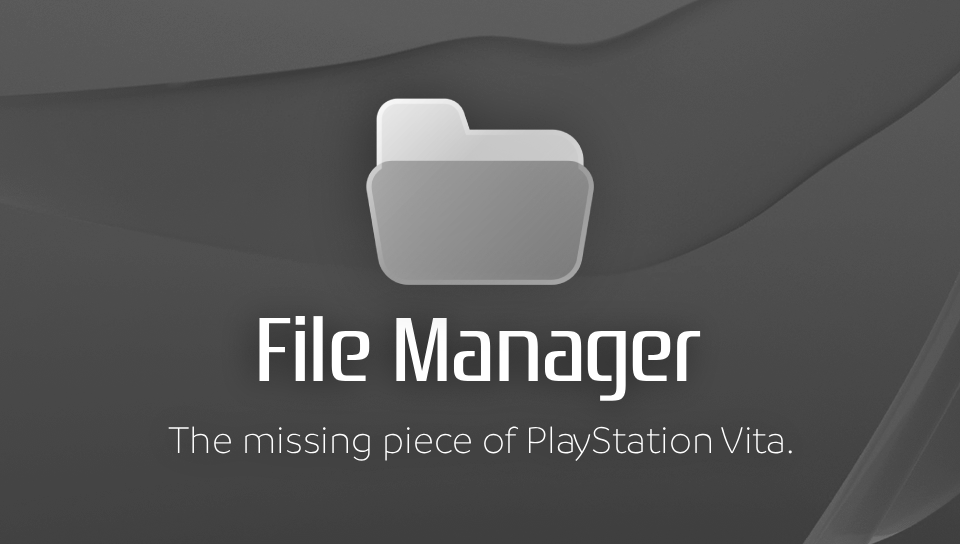
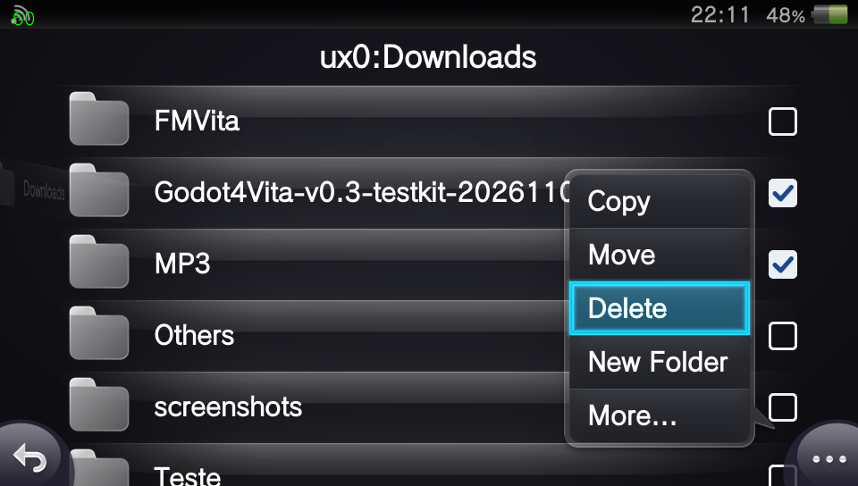
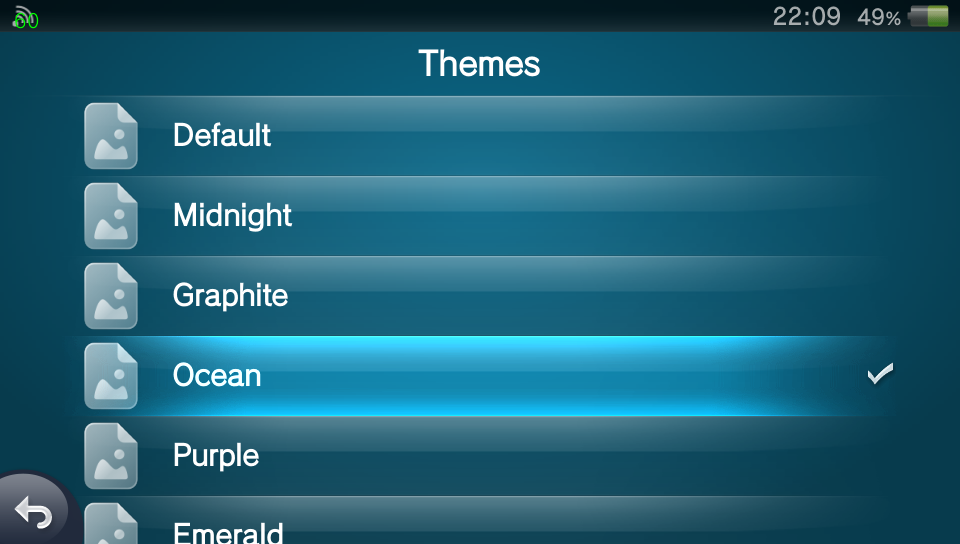
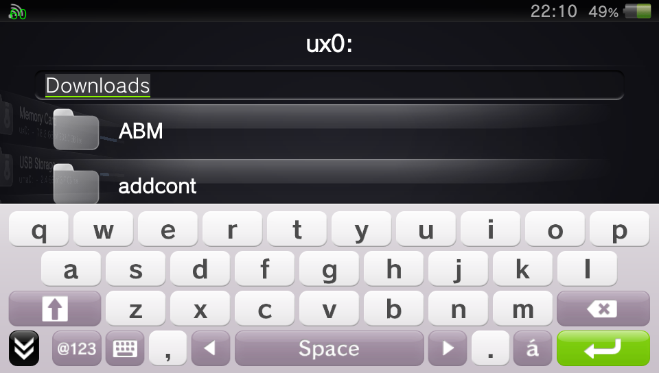
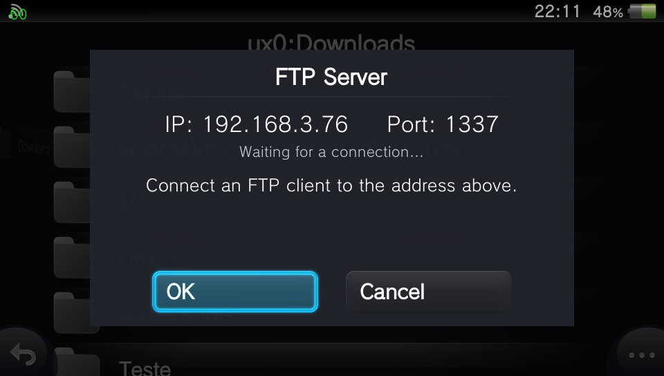
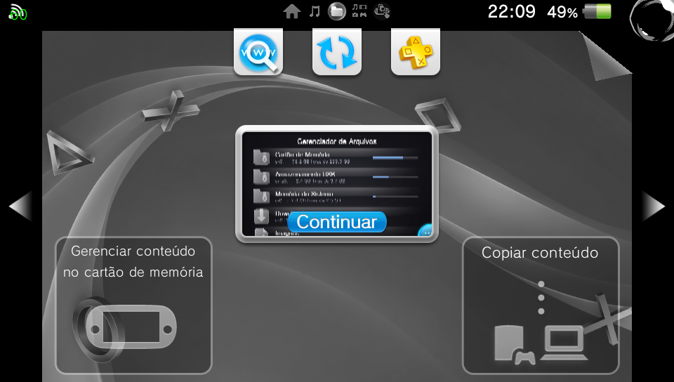

<p align="center">
  
  
</p>

<p align="center">
  <em>A native file manager for PlayStation Vita, built with Sony's ScePaf interface.<br>
  Not just a file manager. A true Vita experience.</em>
</p>

<div align="center">
  <a href="https://github.com/WolffsRoom/FileManager/releases/tag/v0.2.0-beta"></a>
  
  
  <a href="LICENSE"></a>
</div>

---

<details open>
<summary><b>Overview</b></summary>

- [What This Project Is](#what-this-project-is)
- [Features](#features)
- [Screenshots](#screenshots)
- [Controls](#controls)
- [Installation](#installation)

</details>

<details open>
<summary><b>Development</b></summary>

- [Building from Source](#building-from-source)
- [Architecture](#architecture)
- [Current Status and Limitations](#current-status-and-limitations)
- [Credits](#credits)

</details>

---

## What This Project Is

**File Manager** is a file explorer designed specifically for the PlayStation Vita. Unlike most Vita homebrew file managers, its new interface is written on top of **ScePaf**, the PlayStation Application Framework used by Sony's own system applications. It therefore uses native widgets, sounds, transitions and dialogs that feel at home on the console.

The project carries forward the proven file-management logic of [FMVita](https://github.com/WolffsRoom/FMVita), itself based on [VitaShell](https://github.com/TheOfficialFloW/VitaShell), while replacing the previous vita2d interface with a new native application. It has its own Title ID, `FILEMGR01`, and can be installed alongside VitaShell and FMVita.

<p align="center">
  
</p>

> [!WARNING]
> This beta is intended for testing on real hardware. Keep backups of important files before using copy, move, delete, rename or VPK installation features.

## Features

### Native Interface and Navigation

- Native ScePaf widgets, transitions, system sounds and dialogs.
- Storage overview with device capacity, free space and usage bars.
- Quick entries for Downloads, Images, Music, PSP, Trash and system partitions.
- Natural sorting with folders first, multi-selection and touch support.
- Portuguese (Brazil) and English interfaces.
- Eight visual themes plus a custom background at `ux0:data/FileManager/background.png`. Additional PNG images placed in `ux0:data/FileManager/backgrounds/` rotate automatically with a soft fade.

### File Operations

- Copy, move, paste, delete, rename and create folders.
- Native progress dialogs with cancellation support.
- Search, shortcuts and file information.
- Text preview and line-based editing for TXT, INI, XML, LOG, JSON, SFO and unknown text files.
- Image preview and MP4 playback through SceAvPlayer, with sound, seek, pause and L/R navigation.
- MP3 and OGG playback with metadata, embedded cover art, progress, seek and playlist navigation.
- Optional automatic PFS mounting for protected application and savedata folders.

### VPK and Network Tools

- VPK metadata, icon, name, version and Title ID preview.
- VPK extraction and installation through `ScePromoterUtil`.
- FTP server powered by `ftpvita`, with connection and transfer progress.
- Configurable Select-button action; FTP is available and the QR scanner is still being ported.

## Screenshots

<p align="center">
  
  
</p>

<p align="center">
  
  
</p>

<p align="center">
  
  
</p>

<p align="center">
  
  
</p>

<p align="center">
  
</p>

<h2 align="center">Controls</h2>

| Control | Action |
|---|---|
| Cross / touch | Open |
| Circle / lower-left button | Go back |
| Triangle / lower-right button | Options and settings |
| Square / long press | Mark an item |
| Select | FTP server or QR Code, configurable |
| Start | Search in the open folder |
| L / R | First / last list item |
| D-pad left / right | Go back / open focused folder |
| L / R in a preview | Previous / next file |

## Installation

1. Download the latest `.vpk` from [Releases](https://github.com/WolffsRoom/FileManager/releases).
2. Transfer it to the console using USB or FTP.
3. Install it with VitaShell, FMVita or another VPK-capable file manager.
4. Launch **File Manager** from LiveArea.

File Manager uses Title ID `FILEMGR01`, so it installs alongside other file managers without replacing them.

## Building from Source

The provided script uses the standard `vitasdk/vitasdk` Docker image:

```bash
sh scripts/build.sh
```

The resulting package is written to `build/FileManager.vpk`.

The build is hard-float and uses `-mword-relocations`. Both are required for correct ScePaf ABI and imported-variable handling. The build also needs Python 3 for the repository's RCO compiler.

### PC Interface Viewer

Vita3K cannot run ScePaf applications, so `tools/ui_viewer/` provides a browser-based preview for layout, themes, text and navigation-flow validation:

```bash
python tools/rcoc.py compile resource/file_manager_plugin.xml -o build/file_manager_plugin.rco -x build/generated/file_manager_plugin.h
python tools/ui_viewer/export.py
python -m http.server 8178 --directory tools/ui_viewer
```

Open `http://localhost:8178/`. The viewer validates the simulated interface only; real ScePaf behavior, system transitions, native dialogs and sounds must be tested on a PS Vita.

## Architecture

```text
src/                  New C/C++ ScePaf application
  core/               Filesystem, file operations and VPK installation
resource/             RCO interface, localization and textures
tools/rcoc.py         Open RCO compiler used by the build
tools/ui_viewer/      Browser-based interface simulator
paf/                  ScePaf-RE headers, wrappers and NIDs
legacy/               FMVita/vita2d implementation retained as reference
modules/              VitaShell kernel/user modules retained for future work
```

The custom RCO compiler was validated by recompiling NetStream resources and comparing the generated tag and hash ownership data with the original RCO. Its schema was also checked against firmware RCO files. No Sony `acdc.exe` is required.

## Current Status and Limitations

- The application opens and navigates on real PS Vita hardware.
- Core features compile and are present in the beta, but destructive operations still need broad hardware testing.
- Vita3K does not execute ScePaf applications; it is used only as a firmware/resource reference for the PC viewer.
- MP4, MP3/OGG and text editing are implemented but still need broad real-hardware format testing.
- Image swipe, pinch zoom and panning are implemented; rotation/mirroring and QR code support are still being ported.
- Archive browsing, USB mode and some FMVita features are still being ported.

## Credits

File Manager is possible because of the following developers, libraries, applications and reference repositories:

### Project Foundations and Interface Research

- **[TheFloW](https://github.com/TheOfficialFloW)** and VitaShell contributors - original [VitaShell](https://github.com/TheOfficialFloW/VitaShell) file-manager code, VPK workflow and system modules.
- **[WolffsRoom](https://github.com/WolffsRoom)** - [FMVita](https://github.com/WolffsRoom/FMVita), the File Manager redesign, integration and development.
- **[GrapheneCt](https://github.com/GrapheneCt)** - [ScePaf-RE](https://github.com/GrapheneCt/ScePaf-RE), [NetStream](https://github.com/GrapheneCt/NetStream), EMPVA and the core ScePaf research/reference implementation used by this project.
- **[Muhammad Ibrahim / Ibrahim778](https://github.com/Ibrahim778)** - [Better Homebrew Browser](https://github.com/Ibrahim778/BetterHomebrewBrowser), used as an additional ScePaf implementation reference.
- **[ing156](https://github.com/ing156)** - [VitaPlane](https://github.com/ing156/VitaPlane), used as an interface and behavior reference; no VitaPlane UI code is included.
- **Files prototype** - the earlier local ScePaf file-manager prototype that supplied the initial LiveArea workflow and was used to validate the new architecture.

### Libraries and Toolchain

- **[xerpi](https://github.com/xerpi)** - [libftpvita](https://github.com/xerpi/libftpvita) and the original libvita2d ecosystem.
- **[VitaSDK contributors](https://github.com/vitasdk)** - compiler toolchain, platform headers, stubs, packaging tools and the `vitasdk/vitasdk` build image.
- **[Tim Kientzle and libarchive contributors](https://github.com/libarchive/libarchive)** - archive extraction used by VPK installation.
- **[PNG Development Group](https://github.com/pnggroup/libpng)** - libpng image support.
- **[Jean-loup Gailly and Mark Adler](https://github.com/madler/zlib)** - zlib compression.
- **[Yann Collet and Meta](https://github.com/facebook/zstd)** - Zstandard compression.
- **[Lasse Collin and the Tukaani Project](https://tukaani.org/xz/)** - XZ Utils/liblzma.
- **[Julian Seward](https://sourceware.org/bzip2/)** - bzip2 compression.
- **[OpenSSL Project](https://www.openssl.org/)** - libcrypto.
- **[James Clark and Expat maintainers](https://github.com/libexpat/libexpat)** - Expat XML parser.
- **[Python Software Foundation](https://www.python.org/)** - Python runtime used by the RCO and resource tools.
- **[Pillow contributors](https://python-pillow.github.io/)** - image processing used by the LiveArea asset generator.
- **[Kitware and CMake contributors](https://cmake.org/)** - CMake build system.
- **[Docker](https://www.docker.com/)** - reproducible VitaSDK build environment.

### Validation, Assets and Development Support

- **[Vita3K contributors](https://github.com/Vita3K/Vita3K)** - firmware/resource inspection and validation environment. Vita3K does not run the ScePaf application itself.
- **[Icons8](https://icons8.com/)** - source of interface icons adapted from the Liquid Glass icon family.
- **Google Gemini** and **Anthropic Claude** - development support for debugging, analysis, prototyping and implementation.
- **OpenAI Codex** - development support, repository review and release preparation.

All third-party components remain under their respective licenses. File Manager is distributed under the [GNU General Public License v3.0](LICENSE).
